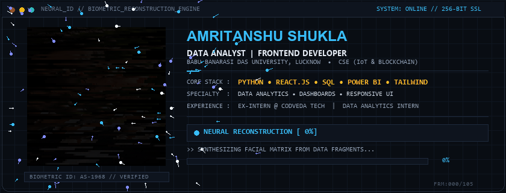

  <picture>
    <source type="image/webp" srcset="assets/banner-ai-scan.webp">
    
  </picture>

  
  
  

  
  
  

---

## 👨‍💻 About Me

I am a final-year **Computer Science Engineering** student specializing in **IoT & Blockchain** at **Babu Banarasi Das University, Lucknow**. I bridge frontend development and data intelligence—engineering responsive, user-centric web applications while transforming complex datasets into meaningful business insights.

My hands-on experience spans developing interactive analytics dashboards, machine learning regression models, and production-ready web platforms with Python, React, SQL, and Power BI.

- 🎓 **Education:** B.Tech in Computer Science Engineering (IoT & Blockchain) *(2023 – Present)*
- 💼 **Frontend Experience:** Former Frontend Development Intern at Codveda Technologies
- 📊 **Analytics & AI:** Currently pursuing Data Analytics Internship & AI Training (Python, SQL, Machine Learning, Power BI)
- 🏅 **Leadership & Discipline:** National Cadet Corps (NCC) 'B' & 'C' Certificate Holder
- 📍 **Location:** Lucknow, Uttar Pradesh, India
- 🚀 **Current Objective:** Open to software engineering internships, frontend roles, and data analytics opportunities

---

## 🛠️ Tech Stack

### 🌐 Frontend & Web Technologies

  
  
  
  
  
  

### 📊 Data Analytics & Business Intelligence

  
  
  
  
  
  
  

### 🤖 Machine Learning & AI Integration

  
  
  
  

### ⚙️ Developer Tools & Cloud Platforms

  
  
  
  
  

---

## 📌 Featured Projects

### 🏙️ Smart City Digital Twin – Enterprise Command Center & Analytics Platform

> **Tech Stack:** Python • SQLite • Power BI • Streamlit • Pandas • NumPy • Scikit-Learn • Git

An enterprise-grade smart city analytics platform that simulates multi-domain IoT telemetry across 10 municipal sectors, loads structured time-series data into a star-schema data warehouse, and surfaces interactive command center dashboards for monitoring traffic congestion, environmental air quality, power grid loads, water consumption, and emergency dispatches.

**✨ Key Architectural Highlights:**
- **Analytical Data Warehouse:** 3 dimension tables and 7 fact tables indexing over 1.2M+ simulated records across traffic, AQI, utilities, and emergency services.
- **Predictive ML Pipelines:** Random Forest regression models for traffic forecasting and Isolation Forest anomaly detection for hardware telemetry.
- **Executive BI Dashboards:** Dual reporting interfaces across Power BI Desktop and a responsive Streamlit operational web app.

🔗 **Links:**  
💻 [GitHub Repository](https://github.com/amritanshu1968-wq/Smart-City-Digital-Twin) &nbsp;|&nbsp; 🚀 [Live Web Application](https://amritanshu1968-wq-smart-city-digital-twin-app-dii0vm.streamlit.app/)

<b>📸 Genuine Project Previews (Click to Expand / Collapse)</b>

 

**1. Executive Command Center & Operational KPIs**

  

**2. Live GIS Command Map & Mobility Analytics**

  

**3. Environmental AQI Profile & Utilities Grid**

  

---

### 🚕 Uber NCR Ride Intelligence & Analytics Dashboard

> **Tech Stack:** Python • Streamlit • Pandas • NumPy • Plotly Express • Plotly Graph Objects • HTML/CSS

A production-grade Business Intelligence dashboard designed to evaluate ride-booking operations, spatial logistics, financial performance, and driver-customer friction patterns across the National Capital Region (NCR) of India using a dataset of 150,000+ booking records.

**✨ Key Features:**
- **Executive Summary:** Live KPI cards for completed trips, total gross revenue, and driver ratings with daily booking curves.
- **Demand & Friction Analysis:** 24-hour demand heatmaps and non-fulfillment audits breaking down driver rejections vs. customer cancellations.
- **Spatial Logistics:** Route flow balance bubble plots and top pickup/drop zone analysis.
- **Revenue Intelligence:** Granular yield metrics grouped by vehicle class and payment method.

🔗 **Links:**  
💻 [GitHub Repository](https://github.com/amritanshu1968-wq/Uber_NCR_Dashboard) &nbsp;|&nbsp; 🚀 [Live Streamlit Dashboard](https://uberncrdashboard-vbczacjhv9ojaq54nhafzq.streamlit.app/Overview)

---

### 🩸 LIFE-LINK – Smart Emergency Blood Coordination Platform

> **Tech Stack:** TypeScript • React.js • Node.js • Express • REST APIs • Tailwind CSS • Vercel

A full-stack emergency healthcare coordination platform designed to bridge communication gaps between patients, hospitals, blood banks, and donors during urgent blood transfusion requirements.

**✨ Key Features:**
- **Multi-Role User Architecture:** Distinct workflows for Donors, Patients, Hospitals, Blood Banks, and System Administrators.
- **Emergency Priority Routing:** Dynamic triaging supporting Normal, Urgent, and Emergency blood requests.
- **Real-Time Request Tracking:** End-to-end lifecycle monitoring from request initiation to clinical fulfillment.
- **Cross-Compatible Blood Matching:** Automated compatibility filtering across all major blood types.

🔗 **Links:**  
💻 [GitHub Repository](https://github.com/amritanshu1968-wq/life-link) &nbsp;|&nbsp; 🚀 [Live Web Application](https://life-link-neon-mu.vercel.app/)

---

### ✍️ AI-Based Blog Generator

> **Tech Stack:** Python • Flask • Groq API (LLMs) • HTML5 • CSS3 • JavaScript • Render

A production-deployed AI content creation web application developed during internship training. It leverages Large Language Models via the Groq API to generate structured, SEO-optimized articles with customizable parameters in seconds.

**✨ Key Features:**
- **Configurable Prompt Engine:** Customizable parameters for tone, target audience, keyword density, and length.
- **Structured Article Output:** Generates formatted headings, meta descriptions, FAQ sections, and article bodies.
- **File Management & Export:** One-click copy to clipboard, automatic server-side text saving, and local history retrieval.

🔗 **Links:**  
💻 [GitHub Repository](https://github.com/amritanshu1968-wq/AI-blog-Generator) &nbsp;|&nbsp; 🚀 [Live Render Deployment](https://ai-based-blog-generator.onrender.com)

---

### 💼 Recruiter-First Developer Portfolio

> **Tech Stack:** React.js • JavaScript (ES6+) • Tailwind CSS • Formspree • Vercel

A modern developer portfolio website built with a recruiter-first design philosophy—enabling prospective employers to evaluate core competencies, live deployments, and credentials within seconds.

**✨ Key Features:**
- **Interactive Project Showcase:** Live previews and direct links to deployed Streamlit, React, and Python applications.
- **Direct Recruiter Contact:** Integrated serverless email endpoint routing messages directly to primary inbox.
- **Fluid Responsive Design:** Fully responsive layout with custom animations and clean typography.

🔗 **Links:**  
💻 [GitHub Repository](https://github.com/amritanshu1968-wq/My-Portfolio) &nbsp;|&nbsp; 🚀 [Live Website](https://my-portfolio-blue-xi-79.vercel.app/)

---

### 🧭 AI Roadmap Generator

> **Tech Stack:** Python • Flask • Groq LLMs • Glassmorphic UI • JavaScript • Render

An interactive learning roadmap web application that generates step-by-step educational paths for any technology, skill, or academic discipline with milestone checklists and export tools.

**✨ Key Features:**
- **Dynamic Curriculum Synthesis:** Generates step-by-step module breakdowns based on user skill level.
- **Interactive Progress Tracking:** Checkbox-based milestone persistence and export capabilities.

🔗 **Links:**  
💻 [GitHub Repository](https://github.com/amritanshu1968-wq/AI-Roadmap-Generator) &nbsp;|&nbsp; 🚀 [Live Demo](https://ai-roadmap-generator-fu1h.onrender.com)

---

### 🏡 Housing.AI – Real Estate Valuation ML Dashboard

> **Tech Stack:** Python • Scikit-Learn • Streamlit • Pandas • NumPy • Plotly

An end-to-end Machine Learning web application designed to analyze California real estate market trends and predict property valuations using trained regression pipelines.

**✨ Key Features:**
- **Predictive ML Pipelines:** Scikit-Learn preprocessing and regression models for real-time house valuation estimates.
- **Dynamic Theming:** Custom Streamlit interface equipped with dark and light theme controls.

🔗 **Links:**  
💻 [GitHub Repository](https://github.com/amritanshu1968-wq/Housing.AI)

---

## 📜 Certifications & Achievements

- 🏅 **NCC 'B' & 'C' Certificate Holder** — National Cadet Corps (India)
- 📊 **IBM Professional Certification** — Data Visualization with Python
- 🤖 **IBM Professional Certification** — Build IoT Apps with Watson, Swift & Node-RED
- 🎓 **Data Science & AI Training Program** — *(Ongoing)*

---

## 📊 GitHub Statistics & Activity

  
  

  

---

## 🐍 Contribution Graph & Activity

  <picture>
    <source media="(prefers-color-scheme: dark)" srcset="https://raw.githubusercontent.com/amritanshu1968-wq/amritanshu1968-wq/output/github-contribution-grid-snake-dark.svg">
    <source media="(prefers-color-scheme: light)" srcset="https://raw.githubusercontent.com/amritanshu1968-wq/amritanshu1968-wq/output/github-contribution-grid-snake.svg">
    
  </picture>

---

## 🌐 Connect With Me

  
  &nbsp;
  
  &nbsp;
  
  &nbsp;
  

---

  <i>"Transforming data into intuitive intelligence, and crafting web applications that make an impact."</i> 
  <b>Amritanshu Shukla</b> • Lucknow, India

